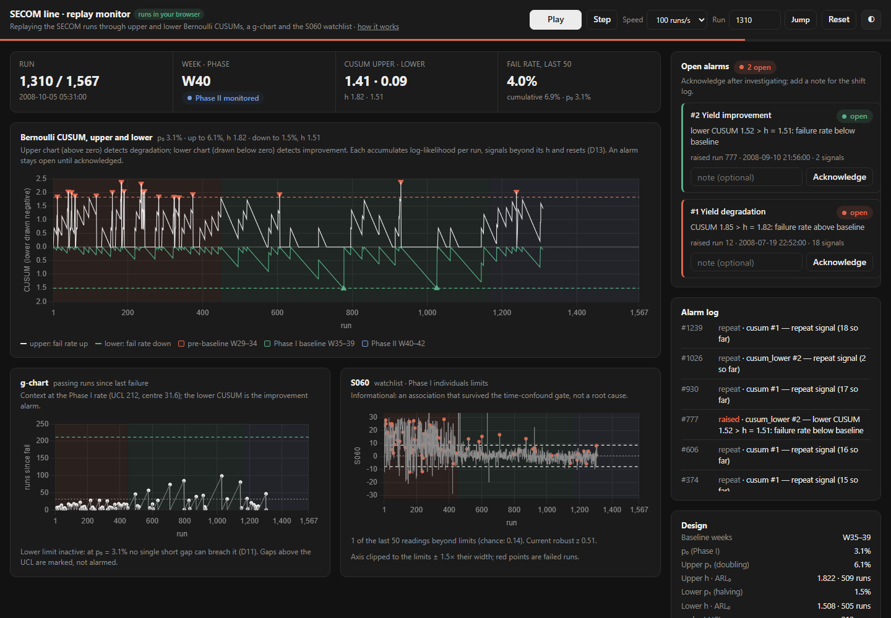

# Replay monitor

`secom monitor` replays the 1,567 SECOM runs in time order through the
recommended monitoring scheme: an upper Bernoulli CUSUM against the week 35–39
baseline as the yield monitor, a lower Bernoulli CUSUM as the improvement
detector, the g-chart for context, and S060 on a watchlist. The page shows that
scheme as a line engineer would see it, one run at a time.

[Try the live monitor](https://syedwajiulhassan715-rgb.github.io/semiconductor-process-control/demo/){ .md-button .md-button--primary }

The live monitor runs entirely in your browser, with nothing to install. Press
**Play**, or add `?autoplay=1&speed=50` to the address.

To run it locally against the Python engine:

```bash
secom monitor                    # http://127.0.0.1:8050/
secom monitor --speed 50 --open  # faster playback, open a browser
secom monitor --export out/demo  # write the static, server-free version
```

=== "Light"

    

=== "Dark"

    

## What it shows

- **Upper and lower CUSUM** on one chart. The upper statistic, plotted above
  zero, accumulates evidence that the fail rate has doubled. The lower one,
  mirrored below zero, accumulates evidence that it has halved. Each has its own
  decision interval, and each signalling run is marked. The upper chart
  reproduces [`bernoulli_cusum`][secom.spc.bernoulli_cusum] exactly, and a test
  asserts it. The lower chart is the same log-likelihood-ratio recursion with
  p₁ < p₀, so passes build it up and failures pay it down.
- **Alarms.** Each statistic resets the moment it signals (D13), but the alarm
  stays open until someone acknowledges it, with an optional note. Further
  signals count against the open alarm, so one excursion is one investigation.
  The upper CUSUM raises *degradation* alarms and the lower one raises
  *improvement* alarms.
- **g-chart** of passing runs since the last failure, tracked live against exact
  geometric limits. It is kept for context, but it no longer raises alarms: the
  report finds the lower CUSUM detects improvement far sooner at the same
  false-alarm risk, and two alarms for one improvement would open the same
  investigation twice. Gaps above the UCL are still marked. At this failure
  rate its lower limit is inactive (D11), and the page says so.
- **S060** against its Phase I individuals limits, for information only. It
  never raises an alarm: the sensor drifts, so an alarm on it would fire
  continually.

On the SECOM runs the upper CUSUM raises its first alarm at run 12, during the
degraded pre-baseline period. The lower CUSUM signals at runs 777 and 1,026,
both inside the baseline, so they fold into one improvement alarm. Those are
false alarms, about as many as an in-control ARL of roughly 500 runs predicts
over 717 baseline runs, and they are left visible on purpose: they show what the
improvement detector's false-alarm budget looks like in practice.

The page has play/pause, single step, speed, jump-to-run and reset controls.
URL options `?theme=light|dark`, `?speed=N` and `?autoplay=1` are there for
demos.

## How it is built

The monitor reads the committed pipeline outputs (`reports/results.json` and
`data/powerbi/`), so it starts in about a second. The lower CUSUM's design
(p₁ = p₀/2 and an h calibrated by simulation to the same in-control ARL as the
upper chart) comes from `results.json` too. If no lower design is there, it
falls back to p₁ = p₀/2 with the upper chart's h, and the page shows the ARL as
not calibrated. After changing the configuration, run `secom run` first so the
monitor picks up the new design.

There is one page, `monitor_static/index.html`, with two backends:

- **Served** (`secom monitor`): the page is a thin client over a JSON API
  (`/api/design`, `/api/state`, `/api/step`, `/api/seek`, `/api/reset`,
  `/api/ack`) served by the Python standard library. The API can be scripted
  directly.
- **Static** (`secom monitor --export DIR`): the page loads
  `monitor-data.json` (the design and the run stream, about 60 kB) and answers
  the same API calls in-process with `engine.js`, a JavaScript port of the
  replay engine. The docs build runs this export into `/demo/` from the
  committed outputs, so the live demo never goes stale.

The CUSUM weights are exported as the exact doubles Python computed. A test
runs `engine.js` under node through steps, seeks, acknowledgements and resets,
and requires every response to equal the Python engine's: every CUSUM value,
alarm and log entry.

The page loads Chart.js from cdnjs, so nothing beyond the core dependencies is
needed. See [`secom.monitor`][secom.monitor],
[`secom.monitor_server`][secom.monitor_server] and
[`secom.monitor_export`][secom.monitor_export], and the operating section of the
[engineering report](report.md) for the design decisions behind it (D34–D36).

To serve it from the Docker image, bind to all interfaces:

```bash
docker run --rm -p 8050:8050 secom-process-control monitor --host 0.0.0.0
```
