# Production test monitoring on the SECOM line

**Dataset:** UCI SECOM — 1,567 production runs, 590 unnamed sensor signals,
pass/fail from in-house line test, 19 Jul – 17 Oct 2008 (89 days), 104 failures
(6.64%).

Every number below is regenerated by `secom run` into `reports/results.json`,
except §9, which `secom validate tep` writes to
`reports/validation/tep_results.json`. Every non-obvious choice is justified in
[`DECISIONS.md`](../DECISIONS.md), referenced inline as **D*n*.**

---

## Summary

1. **The yield change is real and large.** The failure rate falls from 12.92%
   to 4.11% partway through the campaign — an odds ratio of 3.46
   (95% CI 2.26–5.30, Fisher p = 2.0×10⁻⁹).
2. **The standard chart cannot see it.** A weekly p-chart flags one week; after
   the warranted overdispersion correction it flags none. At this failure rate
   the chart is also structurally blind to improvement.
3. **A Bernoulli CUSUM sees it in half a day.** Against the Phase I baseline the
   degraded regime signals after 12 runs (0.46 days); the calibrated
   false-alarm rate is one per ~509 in-control runs.
4. **Of 590 sensors, exactly one survives a time-confound check.** 17 sensors
   associate with failure across the whole campaign; 16 of them are explained by
   drift. Only **S060** discriminates within a stable regime.
5. **Run-level failure prediction does not deploy.** Honest forward evaluation
   gives ROC AUC 0.606 and 3.8% sensitivity. The published-style shuffled split
   reads 0.698 — that gap is leakage, not skill.
6. **A multivariate PCA chart does not do better.** Its textbook limits alarm
   on 15.8% of baseline runs against a nominal ≤ 2%. With limits calibrated out
   of fold it flags 6.9% of degraded-period runs, mostly outliers on a few
   heavy-tailed sensors. It is not adopted as the yield monitor (§6).
7. **The p-chart's blindness is measured, not just argued.** At a doubling of
   the failure rate, a CUSUM held to the p-chart's own false-alarm risk signals
   within 400 runs in 70.0% of simulated streams; the p-chart does in 49.6%.
   At the Phase I rate the p-chart's lower limit is zero in all 14 weeks, so it
   can never signal an improvement (§7).
8. **The change is located at run 375 (21 Aug, W34)**, with a 95% interval of
   runs 280–463 that contains the week-35 baseline boundary. There is no second
   change: after it the process runs at 4.27%, so the 3.07% baseline may be
   optimistic (§8).
9. **The implementation is validated where the truth is known.** On the
   Tennessee Eastman benchmark the repo's PCA code reproduces published T²
   detection rates to a mean gap of 0.027, and the textbook limits hold
   (0.6% in-sample against a nominal 1%). On SECOM the same code alarms on
   12.0%: the calibration failure is a property of the data, not a bug (§9).

The deliverable is a **monitoring** system, not a prediction system. That
conclusion is the finding, not a shortfall.

---

## 1. Data audit

590 raw signals partition cleanly into four dispositions (**D1–D4**):

| Disposition | Sensors | Basis |
|---|---:|---|
| Retained | **412** | — |
| Dropped — constant | 116 | single distinct value |
| Dropped — sparse | 32 | >20% missing |
| Dropped — near-duplicate | 30 | \|r\| ≥ 0.999 with an earlier survivor |

Two audit results matter more than the counts.

**The thresholds are not tuning knobs.** Missingness is bimodal: 506 sensors sit
at or below 3.3%, then a gap to 16.6%. *Any* cutoff in [0.175, 0.456] drops
exactly the same 32 sensors (**D2**). Retention moves only 412 → 405 / 418 when
the duplicate threshold is re-run at 0.99 / 0.9999, and no conclusion changes
(**D4**).

**Constants are resolved before duplicates (D3).** 111 of the 116 constants are
all-zero and collapse into 7 byte-identical groups, one with 41 members. Other
SECOM write-ups report 116 constants *and* 104 duplicates additively; the 104 are
a subset. After removing constants, no two live sensors are exact duplicates.

### Missingness is uninformative — tested, not assumed

Fisher's exact test of missing-vs-present against pass/fail, for all 538 sensors
with any gaps: **0 significant after FDR** (min q = 0.102). Only 8 reach raw
p < 0.05 against ~26.9 expected by chance — fewer than chance, not more.
Imputation therefore destroys nothing, and no missingness indicator is carried
(**D6**).

### Imputation is causal

The load-bearing decision of the project (**D5**). Every imputed value is
computed only from runs that had already happened: trailing rolling median
(window 25 ≈ half a shift) → expanding median over prior runs → first observed
value. Only the last step looks forward, it is unavoidable, and its exposure is
measured: **20 cells in 645,604 (0.0031%)**. Total imputation touches 1.22% of
cells.

A centred rolling median would impute better and leak the future backwards.
Since the question is whether these signals can support *live* monitoring, an
imputation that could not run in real time would invalidate the answer.
`test_imputation_cannot_see_the_future` mutates every value after a gap and
asserts the imputed value is unchanged.

---

## 2. Yield behaviour

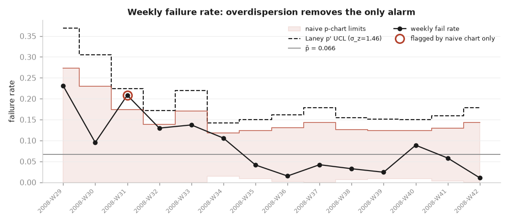

The campaign splits into two regimes:

| Regime | Runs | Failures | Rate |
|---|---:|---:|---:|
| Before ISO week 35 | 449 | 58 | **12.92%** |
| Week 35 onward | 1,118 | 46 | **4.11%** |

Odds ratio **3.46** (95% CI 2.26–5.30), Fisher p = **2.0×10⁻⁹**. Whatever
changed around week 35 roughly tripled the odds of passing.

### Why the p-chart misses it

Three separate reasons, all reported rather than buried:

- **Overdispersion (D9).** σ_z = 1.463 — week-to-week variation is 46% wider
  than binomial sampling explains (χ² = 60.0 on 13 df, p = 5.2×10⁻⁸). The Laney
  p′ correction is therefore warranted. Consequence: the naive chart flags **1**
  week (2008-W31); the corrected chart flags **0**. Widening the limits by 1.46×
  absorbs every point.
- **A structural blind spot (D8).** At p̄ = 6.64% a subgroup needs
  n ≥ 9(1−p)/p = **127 runs** before the lower limit clears zero. **7 of 14
  weeks** fall below that, so the chart *cannot* signal that yield improved —
  which is exactly what happened. The model surfaces this as
  `[Improvement Detectable]` rather than leaving a user to discover it.
  Centred on the Phase I rate the threshold rises to n ≥ 284, and every week
  falls short; §7 measures the consequence by simulation.
- **Thin Phase I.** 14 weekly subgroups, below the ~25 Phase I normally wants.
  Stated as a real limitation.

The correct reading is not "the process is fine." It is that the weekly failure
rate varies far more than sampling explains, so a proportion chart at this grain
cannot separate signal from process noise — the variation has to be attributed
another way.

Two centre lines are exported deliberately (**D10**): all-weeks (p̄ = 0.0664,
answering *was this process ever in control?*) and Phase I-centred (p̄ = 0.0307,
answering *is this week consistent with baseline?*). Under the Phase I centre,
σ_z rises to 2.250 and W31 flags.

### The g-chart covers half the gap

A runs-between-failures chart (**D11**) needs no subgrouping and its upper limit
responds to a single long clean run; centre line 14.07 runs, 1 violation. Its
stated limit: P(gap = 0) equals p exactly, so once p exceeds ~0.14% the lower
quantile pins to zero and no single gap, however short, can breach it. At the
3.07% baseline **this chart detects improvement only** — asserted in
`test_lower_limit_is_inactive_at_realistic_failure_rates` so it cannot be quietly
forgotten. It is not the answer on its own.

---

## 3. The monitoring scheme that works

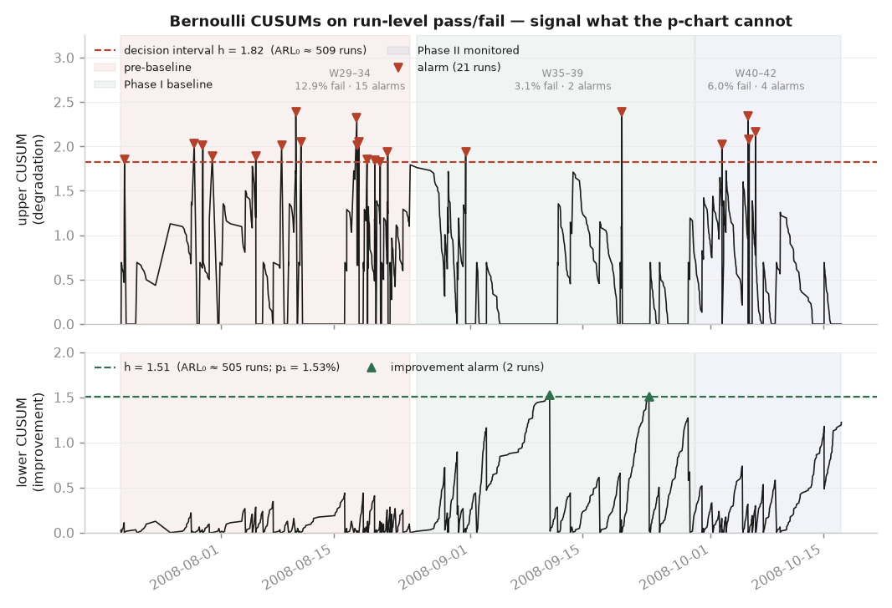

Shewhart charts judge each subgroup alone, so they react to spikes and are worst
at a sustained level shift — precisely what happened here. A Bernoulli CUSUM
accumulates the per-run log-likelihood ratio and needs no subgrouping (**D12**).

**Phase I baseline: ISO weeks 35–39** (**D7**) — 717 runs, 22 failures,
p₀ = 3.07%, chosen as the longest contiguous stretch whose weekly standardised
proportions all fall within ±2.4σ of their own mean. Limits are estimated once
here and held fixed; recomputing from all data — the tutorial default — lets an
excursion inflate the very limits meant to catch it.

**Design:** p₀ = 0.0307 → p₁ = 0.0614 (a doubling, the smallest shift worth
detecting). Threshold **h = 1.822 obtained by simulation** for an in-control ARL
of ~500 runs (achieved **509**), not guessed — the Bernoulli CUSUM lives on a
lattice of two increment sizes, where continuous ARL approximations are poor at
low p₀.

| Window | Runs | Failures | Rate | Runs to signal | Days | Alarm episodes |
|---|---:|---:|---:|---:|---:|---:|
| Pre-baseline (degraded) | 449 | 58 | 12.92% | **12** | **0.46** | 15 |
| Baseline self-check | 717 | 22 | 3.07% | 157 | 6.06 | 2 |
| Phase II (forward) | 401 | 24 | 5.99% | 73 | 3.29 | 4 |

The baseline self-check is the guard on **D7**: 2 alarm episodes against ~1.4
expected is consistent with a genuinely stable window, so the baseline does not
secretly contain an excursion.

**The CUSUM resets on signal (D13)** — found by inspecting the figure, not by
reasoning. Without a reset the opening excursion drives the statistic to ~28, and
since each passing run pays down only log((1−p₁)/(1−p₀)) ≈ 0.031, it would take
roughly 900 consecutive good runs to fall back below the limit. The chart read as
alarming for the entire 89 days, including the five weeks the process was
demonstrably healthy. Reset-on-signal is how a CUSUM is actually operated: it
signals, an engineer investigates, the chart restarts against the process as it
now stands.

---

## 4. Which sensor, if any, explains it

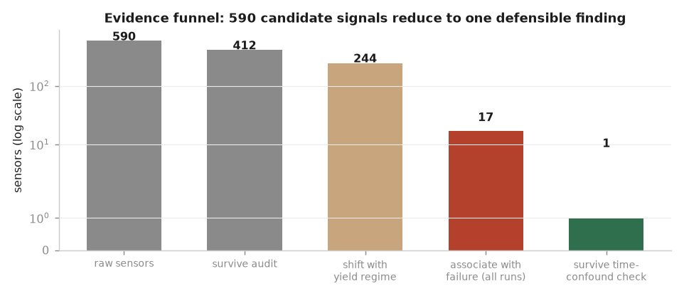

### The confound that invalidates the obvious analysis

**293 of 412 retained sensors (71.1%) show significant monotone drift against run
order.** The failure rate also changes over time. So any sensor that drifts will
correlate with failure for reasons that have nothing to do with causing it
(**D15**).

Significance alone fails in the other direction too (**D14**): **244 of 412
sensors (59%) shift significantly between regimes**, but only **8** have
\|Cliff's δ\| > 0.5. At n = 449 vs 717 a q-value measures sample size as much as
it measures effect. Benjamini-Hochberg FDR is applied throughout (validated
against `statsmodels` to 2×10⁻¹⁶), and rankings use rank-based tests with
Cliff's δ rather than Welch and Cohen's d — several SECOM sensors have excess
kurtosis above 60, where d reads ~0.15 while δ reads ~0.65.

### The gate

A sensor must discriminate fail from pass **within the stable Phase I window**,
where the regime is constant.

| Screen | Sensors passing |
|---|---:|
| Shift with yield regime (q < 0.05) | 244 |
| Associate with failure, all runs (q < 0.05) | 17 |
| **Also discriminate within the stable regime** | **1** |

Within the stable window, 35 sensors reach raw p < 0.05 against 20.6 expected by
chance; after FDR, one survives. 16 of the 17 whole-dataset hits have substantial
drift and a non-significant within-regime p-value — they are confounded, and
reporting them as root causes would be wrong. Without this gate the report would
have named 17 root causes, 16 of them artefacts.

### S060

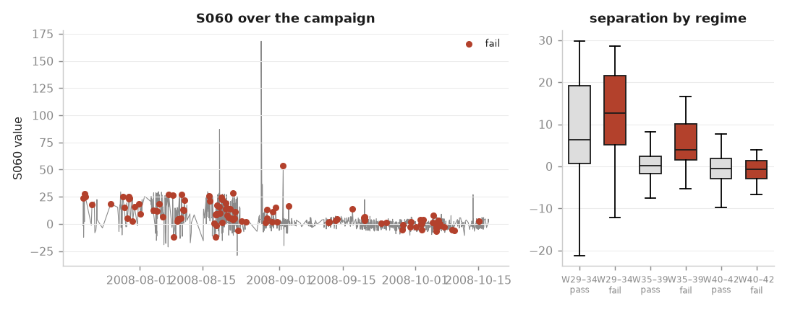

The single survivor: drift ρ = −0.442, within-stable-regime p = **5.6×10⁻⁶**.
It is described by its statistical behaviour only; the signals are anonymised and
naming it as a specific process parameter would be invention (**D23**).

**The caveat travels with the finding.** S060's association is strong in W29–34
(δ = 0.21) and W35–39 (δ = 0.57) but **absent in W40–42** (δ = −0.04, p = 0.76).
Either the mechanism changed or the association was never causal. This is stated
as a caveat on the recommendation, not omitted (**D24**).

---

## 5. Can failures be predicted per run?

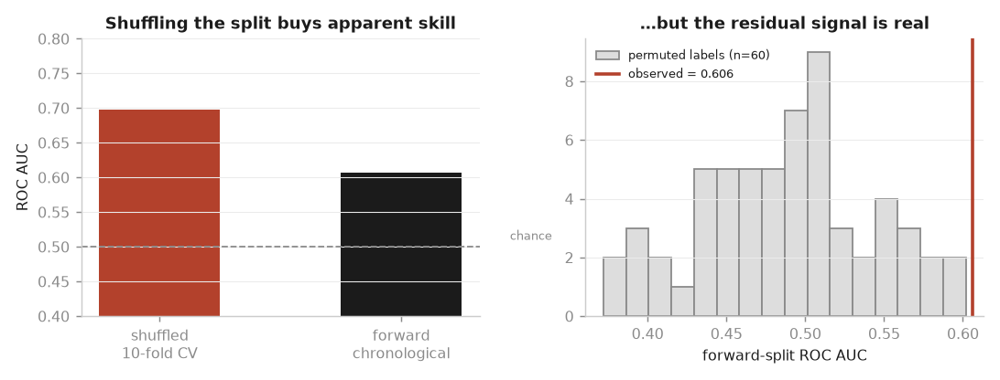

The published SECOM baselines use 10-fold CV, which trains on October to predict
August. With 71% drift and a failure rate that halves partway through, a shuffled
split lets a model learn *when* a run happened. A monitoring model can only see
the past, so **the forward chronological split is the primary result** and the
shuffled one is computed only to measure how much optimism the shuffle buys
(**D16**).

| Protocol | Model | BER | Sensitivity | ROC AUC | PR AUC |
|---|---|---:|---:|---:|---:|
| Shuffled 10-fold | logistic L2 | 0.373 | 0.433 | 0.698 | 0.152 |
| Shuffled 10-fold | grad. boosting | 0.470 | 0.106 | 0.715 | 0.148 |
| **Forward chronological** | **logistic L2** | **0.504** | **0.038** | **0.606** | **0.073** |
| **Forward chronological** | grad. boosting | 0.502 | 0.000 | 0.565 | 0.072 |

**BER 0.373 → 0.504.** Balanced error under the honest protocol is
indistinguishable from a coin flip, and gradient boosting flags *nothing*
(sensitivity 0.000). Two deliberately different model families (**D18**) reach
the same ceiling, so the limit is informational, not a modelling failure. Class
imbalance is handled by `class_weight='balanced'` rather than SMOTE, so no
synthetic rows enter the evaluation (**D17**).

**Robustness — the forward number is not one unlucky cut.** Rolling-origin
evaluation across 8 cut points gives mean AUC **0.641 (sd 0.106)**;
grouped-by-week CV lands at 0.652, between the two, showing the leakage is partly
within-week and partly future-information.

**The residual signal is real but small.** A 60-run label permutation puts the
null at AUC 0.487 (sd 0.054) against an observed 0.606 — p = 0.0. There is
genuine signal. It is just not enough to act on.

### What that means for review effort

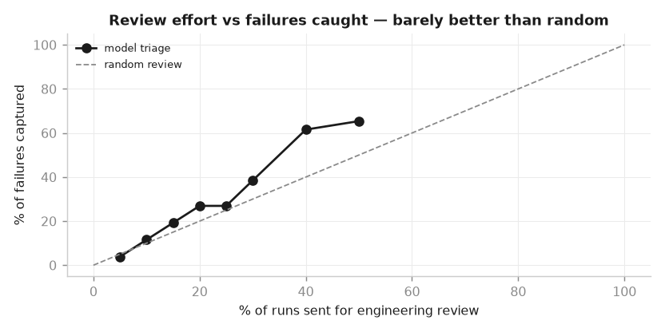

| Review budget | Runs flagged | Failures caught | Capture | Lift |
|---:|---:|---:|---:|---:|
| 10% | 47 | 3 | 11.5% | 1.16 |
| 20% | 94 | 7 | 26.9% | 1.35 |
| **40%** | 188 | 16 | 61.5% | **1.54** |
| 50% | 235 | 17 | 65.4% | 1.31 |

Best achievable lift is **1.54× random, at a 40% review budget**. Re-inspecting
40% of production to catch 62% of failures is not a defensible operating point.
The triage rate is left interactive in the Power BI model (**D20**) so a reviewer
drags the budget slider and sees the weak lift themselves.

---

## 6. Multivariate monitoring: PCA T² and SPE

Fab FDC systems don't watch 412 sensors one at a time. They fit a PCA model to
a known-good window and run two charts:

- **Hotelling's T²** flags runs that sit unusually far out *inside* the model's
  component space.
- **SPE (Q)** flags runs whose sensor pattern the model can't reproduce.

This section asks whether that chart adds anything to the Bernoulli CUSUM.
Specifically, does it detect the yield degradation, or does it mostly detect
the sensor drift that §4 showed affects 71% of retained sensors? Every number
here is under `multivariate` in `results.json`.

### The model

Fitted once on the Phase I baseline (weeks 35–39, 717 runs) and held fixed
for every run (**D26**):

- 411 of the 412 retained sensors. S075 is constant within the baseline and is
  dropped.
- Scaling uses the baseline mean and SD. Robust scaling isn't possible here,
  because 8 sensors have a baseline MAD of zero.
- **A = 81 components**, chosen by an 80% cumulative-variance rule (**D28**).
  They explain 80.1% of baseline variance. The spectrum is flat: the first
  component explains only 6.7%, and 105 eigenvalues exceed 1.
- The baseline has full rank (411), but its smallest eigenvalue is 3.5×10⁻¹¹.
  T² is therefore computed only from the retained components, whose condition
  number is 18.9; the full covariance is never inverted.

### The textbook limits do not hold on this data

The standard limits at α = 0.01 per chart are:

- **T²:** exact F limit 131.4 for new runs; Beta limit 110.9 for the baseline
  points themselves.
- **SPE:** Jackson–Mudholkar limit 111.5.

Applied to the baseline that defined them, **15.8% of baseline runs alarm**
against a nominal 2% or less: 12.0% on T² and 7.5% on SPE. Under these limits
the chart flags **86% of the degraded-period runs and 83% of Phase II runs**.

That looks like overwhelming detection, but it is an artefact. Alarmed runs in
the degraded period fail at 13.1%, quiet ones at 11.5% (Fisher p = 0.84). The
chart is flagging nearly everything because the limits are wrong. The cause is
the heavy tails: the limits assume multivariate normality, but the top
contributors to the alarms have excess kurtosis in the hundreds.

The limits are therefore recalibrated (**D27**):

1. Score every baseline run **out of fold**, using a model fitted on the other
   four contiguous time blocks of the baseline.
2. Set each limit at the 99% quantile of those out-of-fold scores.

This gives T² = 902.7 and SPE = 2,204.5, with 8 of 717 baseline runs above
each, so 1.1% of baseline runs alarm. α stays at 0.01 rather than the 3-sigma
0.27% used elsewhere. The out-of-fold statistics have excess kurtosis of 712
(the largest T² is 1.4 million), so their 99.73% quantile rests on about two
runs and can't be estimated: it comes out at 8,328.

### What the calibrated chart sees

<p align="center">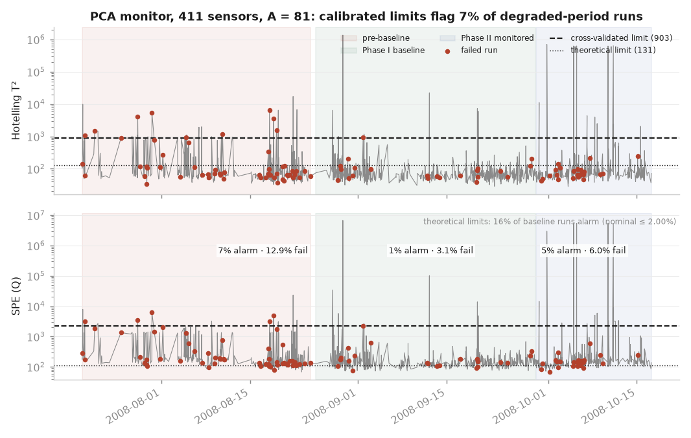</p>

| Window | Runs | Fail rate | Runs alarming (T² or SPE) | Alarmed vs quiet fail rate | Fisher p |
|---|---:|---:|---:|---|---:|
| Pre-baseline (degraded) | 449 | 12.9% | 6.9% (31) | 29.0% vs 11.7% | 0.011 |
| Phase I baseline (out of fold) | 717 | 3.1% | 1.1% (8) | 12.5% vs 3.0% | 0.22 |
| Phase II (forward) | 401 | 6.0% | 4.7% (19) | 0.0% vs 6.3% | 0.62 |

**The monitoring statistic moves with time, not with yield.** Compared with
the out-of-fold baseline, median SPE is higher in the degraded period
(157 vs 133, Cliff's δ = 0.29, p = 2×10⁻¹⁷), and still higher in Phase II
(139, δ = 0.13, p = 3×10⁻⁴). The Phase II shift appears even though Phase II
yield is better. T² behaves the same way (δ = 0.18 and 0.12). The chart is
measuring how far a run sits from the baseline weeks, and the sensor drift
moves runs away from those weeks in both directions in time.

**Alarms mark failures in one window only.** In the degraded period, the 31
alarmed runs fail at 29.0% against 11.7% for the rest (odds ratio 3.08,
p = 0.011). It doesn't replicate:

- In the baseline, 8 alarms give p = 0.22.
- In Phase II, none of the 19 alarmed runs failed.

How robust is it? The degraded-period association holds across the number of
components: p ranges from 0.001 to 0.012 for A = 30 to 150. It does not hold
across the alarm threshold:

| α per chart | 0.05 | 0.02 | 0.01 | 0.005 |
|---|---:|---:|---:|---:|
| Fisher p, degraded period | 0.092 | 0.045 | 0.011 | 0.50 |

Three regimes were tested, so p = 0.011 alone does not survive a Bonferroni
correction at 0.05/3 by a wide margin. It is a lead, not a finding. The
whole-campaign association (17.2% vs 6.2%, p = 0.004) is the same time
confound §4 removed from the sensor screen: alarms concentrate in the weeks
that also had the most failures.

**Detection speed is not comparable with the CUSUM.** The chart's first
degraded-period alarm comes at run 4 (0.12 days), against the CUSUM's 12 runs.
But a 1.1% per-run false-alarm rate implies an in-control ARL of about 90
runs, against the CUSUM's 509, and the baseline's own first false alarm comes
at run 9. The earlier first signal reflects a chart that alarms more often,
not one that detects better.

### Who drives the alarms

<p align="center">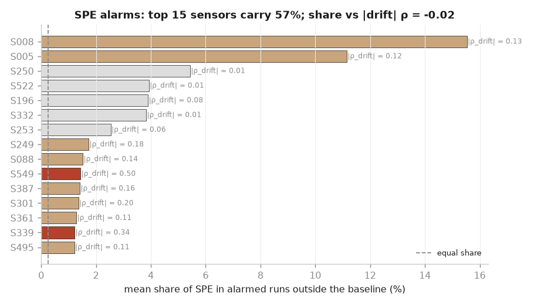</p>

The 29 SPE alarms outside the baseline are not spread across the drifting
sensors:

- They are concentrated in a few sensors with extreme tails. S008 carries
  15.5% of the SPE in an average alarmed run and S005 11.2%, against an equal
  share of 0.24%.
- The top 15 sensors carry 57%. Their median excess kurtosis is 276, against
  14 across all sensors.
- In 38% of alarmed runs, one sensor alone is more than half the statistic.
- A sensor's contribution share is unrelated to its drift (Spearman ρ = −0.02,
  p = 0.64). For T², the relationship is slightly negative (ρ = −0.11).

So the calibrated alarms are mostly **outlier events on individual
heavy-tailed sensors**, not a broad multivariate departure. The broad drift
shows up in the median statistic (above) but rarely crosses a limit.

**S060 does not appear.** It ranks 259th of 411 in SPE contribution and 192nd
in T². This is consistent with §4: S060's association with failure is a shift
small enough to be invisible in a 411-sensor statistic. Contribution analysis
cannot substitute for the targeted screen.

<p align="center">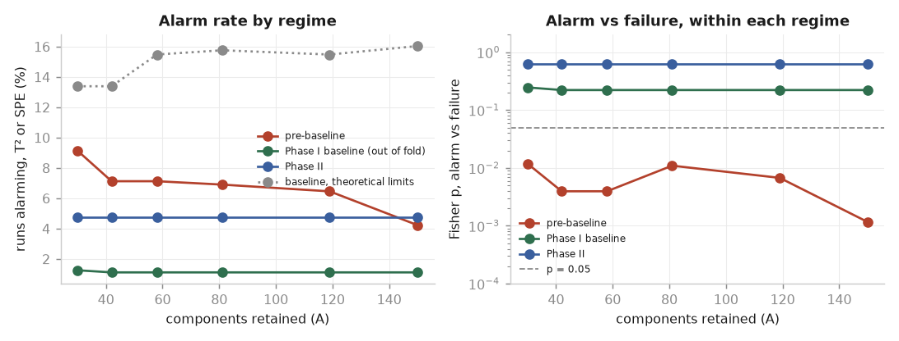</p>

The component count doesn't change any of this:

- Across A = 30 to 150, the out-of-fold baseline alarm rate stays at 1.1–1.3%.
- The theoretical limits stay miscalibrated at 13.4–16.0%.
- Phase II never shows a within-regime association (p = 0.62 at every A).

### Verdict

Don't adopt the PCA chart as the yield monitor (**D29**):

- With honest limits it flags 6.9% of runs in the period when yield was worst.
- The alarms that do fire are mostly single-sensor outliers.
- They mark failures in one of three windows only, and that result is
  sensitive to the threshold.

As textbook limits would deploy it, the chart would alarm on 86% of production,
which is worse than having no chart. Its practical use here is as an
**excursion flag for the handful of heavy-tailed sensors**, with limits taken
from out-of-fold baseline quantiles, never from the F or Jackson–Mudholkar
formulas. The Bernoulli CUSUM remains the yield monitor.

---

## 7. Detection power, measured rather than argued

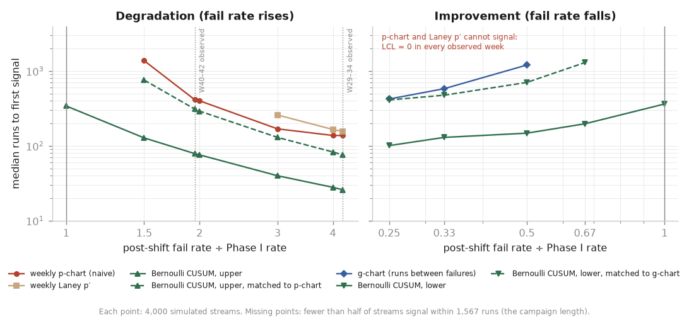

Sections 2 and 3 argue that the weekly p-chart cannot see the yield shift and
the Bernoulli CUSUM can. That argument rests on control-limit algebra and on one
realised campaign. This section measures it. Pass/fail streams are simulated with
the fail rate stepping from the Phase I rate p₀ = 3.07% to r·p₀, and every scheme
is run over the same streams with the limits and designs the pipeline actually
uses (**D30**). There are 4,000 streams per ratio, and the ratios include the
two observed ones: **4.21×** for W29–34 and **1.95×** for W40–42.

The Shewhart results don't depend on the simulation alone. Subgroups are
independent binomials, so every p-chart detection probability also has an exact
value. The 99 simulated Shewhart probabilities agree with the exact ones to
within **0.0146**, against a worst-case Monte Carlo standard error of 0.0079.

### The comparison has to be matched

As deployed, the two schemes are not on equal terms. The CUSUM was designed for
an in-control ARL of ~500 runs (**D12**), which gives it a **96.6%** chance of at
least one false alarm over a 1,567-run campaign. The naive weekly p-chart's
chance is **7.3%**. Comparing them as deployed partly compares false-alarm
budgets. So each one-sided CUSUM is also run with h chosen to match the
false-alarm probability of the chart it is compared with (**D31**):

- **Upper CUSUM, matched to the p-chart:** h = 4.996, false-alarm probability
  7.6% simulated against a target of 7.2%.
- **Lower CUSUM, matched to the g-chart:** h = 4.626, 4.8% against a target of
  5.0%.

A detection only counts if the signal points the same way as the shift
(**D32**). For example, when the fail rate falls, a p-chart point above the UCL
is a false alarm, not a detection.

### Degradation

| Scheme | False alarm in 1,567 runs | 2×: P(signal ≤ 400 runs) | 2×: median runs | 4.21×: P(signal ≤ 120 runs) | 4.21×: median runs |
|---|---:|---:|---:|---:|---:|
| Weekly p-chart (naive) | 0.073 | 0.496 | 401 | 0.402 | 138 |
| Weekly Laney p′, σ_z = 1.463 | 0.004 | 0.128 | — | 0.291 | 156 |
| Weekly Laney p′, σ_z = 2.250 | 0.000 | 0.005 | — | 0.084 | 249 |
| **CUSUM as deployed** | 0.966 | **0.992** | **76** | **0.998** | **26** |
| **CUSUM matched to p-chart** | 0.076 | **0.700** | **292** | **0.871** | **76** |

"—" means fewer than half the streams signal within 1,567 runs. The 2× row
stands in for W40–42, which was observed at 1.95×; the simulation gives nearly
identical figures there (0.990 and 0.659 for the two CUSUMs within 400 runs).

**The CUSUM's advantage survives matching, but it is smaller than the deployed
design suggests.** At equal false-alarm risk:
- At a doubling, the CUSUM catches the shift within 400 runs 70% of the time,
  against 50% for the p-chart, with a median delay of 292 runs against 401.
- At the degradation actually observed in W29–34, it signals within about a
  week (120 runs) 87% of the time against 40%, with a median delay of 76 runs
  against 138.
- The deployed design's headline figure (99% within 400 runs at 2×) is mostly
  bought with a much larger false-alarm budget: 97% per campaign against 7%.

The real structural gap is in the p-chart's timing, not its sensitivity. A
weekly chart can only signal at the end of a week, so its median delay never
falls below about one subgroup. Even at 4.21×, the p-chart's median is 138
runs, while the deployed CUSUM's is 26.

**The Laney correction costs real power.** At a doubling, Laney p′ signals
within 400 runs in 13% of streams against 50% for the naive chart. With the
Phase I-centred σ_z of 2.250 that falls to 0.5%. That is the price of being
honest about overdispersion (**D9**) at this grain. The correction is right,
and the chart it produces is close to inert.

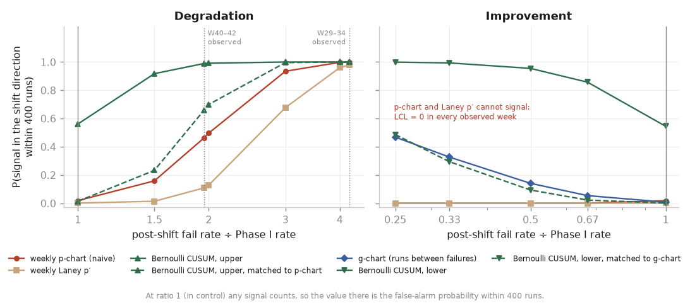

### Improvement

| Scheme | False alarm in 1,567 runs | 0.5×: P(signal ≤ 1,567) | 0.5×: median runs | 0.33×: P(signal ≤ 400) | 0.33×: median runs |
|---|---:|---:|---:|---:|---:|
| Weekly p-chart, either correction | — | **0.000** | — | **0.000** | — |
| g-chart | 0.052 | 0.605 | 1,204 | 0.326 | 582 |
| Lower CUSUM as deployed | 0.973 | 1.000 | 148 | 0.994 | 130 |
| Lower CUSUM matched to g-chart | 0.048 | 0.949 | 705 | 0.294 | 476 |

**The blind spot is total at the monitoring centre line.** Against p₀ = 3.07%, a
weekly subgroup needs n ≥ 9(1−p₀)/p₀ = **284** runs before the lower limit clears
zero. The largest week has 208, so the LCL is zero in **all 14** weeks. The
improvement-detection probability is therefore exactly zero for every ratio and
horizon, both in simulation and in the exact calculation. This is stronger than
the 7 of 14 weeks in Section 2, which uses the all-weeks centre p̄ = 6.64%. At
the centre a monitoring chart actually uses, no week can show an improvement.

The g-chart covers the gap, but slowly. With UCL = 212 it cannot signal before
213 consecutive passes. At equal false-alarm risk the lower CUSUM is better over
a full campaign: it catches a halving 95% of the time against 61%, with a median
of 705 runs against 1,204. Over shorter horizons the two are close, and the
g-chart is slightly ahead within 400 runs (0.326 against 0.294 at 0.33×),
because the matched CUSUM's large h needs a long run of passes before it can
signal at all.

### What this changes

- **The Section 3 recommendation stands, on firmer ground.** The CUSUM beats
  the p-chart at every degradation ratio, including at matched false-alarm
  risk.
- **The deployed CUSUM's operating cost is now explicit.** In control, half of
  all streams false-alarm within 342 runs. At the observed cadence of 1,567
  runs in 89 days, that is under three weeks. The baseline self-check (2 alarm
  episodes in 717 runs) is consistent with that. It is a design choice, not a
  defect, and whoever runs the chart should be told it.
- **If detecting improvement matters,** a lower CUSUM should replace the
  g-chart as the improvement detector. The g-chart is defensible only as a
  readable companion chart.

### Limits of the simulation

- **Streams are independent Bernoulli.** The real weekly rates are
  overdispersed (σ_z = 1.46). Under overdispersion every scheme false-alarms
  more than simulated, and run-level accumulators like the CUSUM are affected
  most. The in-control figures above are lower bounds on real false-alarm
  rates.
- **Shewhart timing is favourable.** Shifts start at run 1, so the first weekly
  subgroup is wholly post-shift. A mid-week shift would cost the weekly charts
  up to one more week, so their delays here are best cases.
- **Only step shifts are modelled.** Gradual drifts are not, and an EWMA was not
  simulated.

---

## 8. Where the yield changed, located at run grain

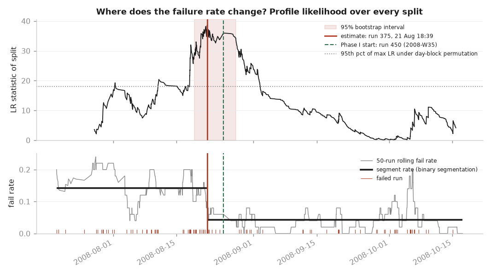

The Phase I baseline starts at ISO week 35 because that is where the weekly rates
settle (**D7**). That is a judgement made at week grain. This section locates the
change at run grain instead, without a week boundary (**D33**):
- **The estimate:** the exact maximum-likelihood single change point of the
  1,567-run pass/fail sequence. The profile likelihood is evaluated at every
  split, so no search heuristic is involved.
- **The test:** a likelihood-ratio test of "no change".
- **The interval:** a parametric-bootstrap confidence interval for the change
  location.
- **Further changes:** binary segmentation to look for additional change points.

### Result

| | Before | After |
|---|---:|---:|
| Runs | 374 | 1,193 |
| Failures | 53 | 51 |
| Rate | **14.17%** | **4.27%** |

**The change falls at run 375, 21 Aug 2008 18:39, in ISO week 34.** The rate
drops by a factor of **3.31**, with LR = 38.59. The 95% bootstrap interval runs
from run 280 (18 Aug 23:03, W34) to run 463 (28 Aug 03:45, W35).

The evidence is unambiguous under either null:
- Run-level permutation and day-block permutation (86 calendar-day blocks) both
  give p = 0.0005. That is the smallest value 2,000 permutations can produce,
  so p < 0.001.
- The block null matters. Under day-block permutation, the 95th percentile of
  the maximum LR is **18.07**; under run-level permutation it is 10.42.
  Failures cluster within days, which roughly doubles the evidence needed to
  call a change, and the observed 38.59 clears both.

### Agreement with the Phase I boundary

**The change point agrees with D7.** The first baseline run (run 450, 25 Aug
09:29, W35) lies inside the interval, 75 runs (86.8 hours) after the point
estimate. Starting the baseline at the week boundary is slightly conservative:
the transition stays out of Phase I under the point estimate. Even at the far
end of the interval, only 13 of the 717 baseline runs could precede the change.

The run-level estimate sharpens one statement in the report. The "pre-baseline"
regime in Sections 2 and 3 is weeks ≤ 34 (12.92%). It includes the 75 runs of
week 34 that already belong to the improved process. Split at the estimated run
instead, the contrast is 14.17% against 4.27%.

### No second change point, and what that implies

Binary segmentation splits a segment while its day-block permutation p stays
below 0.05. It keeps only the one change:

| Segment tested | Best split | LR | p (run-level) | p (day-block) |
|---|---:|---:|---:|---:|
| Runs 1–374 | run 66 | 4.60 | 0.366 | 0.615 |
| Runs 375–1,567 | run 1,445 | 5.75 | 0.329 | 0.722 |

The second line matters for the monitoring design. After the change, the
process runs at 4.27% overall, and the data cannot separate the Phase I weeks
(3.07%) from W40–42 (5.99%) as distinct regimes. The CUSUM's four Phase II alarm
episodes (Section 3) are measured against the Phase I rate. This result says
they may reflect ordinary variation of the post-change process, not a new
degradation.

**The boundary of the baseline is right; its level may be optimistic.** If
W35–39 was a favourable stretch of a process whose sustained rate is nearer 4.3%,
then a CUSUM designed on p₀ = 3.07% will alarm more often than its designed
ARL₀. p₀ should be re-estimated as post-change data accumulates. This is a
caveat on the recommendation, not a reversal of it.

### Limits

- **The bootstrap interval assumes independent Bernoulli runs.** Day-level
  clustering makes the real interval wider than the one shown. The permutation
  tests account for the clustering; the interval does not.
- **Binary segmentation does not adjust alpha for the number of tests.** Each
  later test is also conditional on the earlier split, so treat secondary splits
  as descriptive. Here none were accepted, so this only matters in the
  conservative direction.
- **No segment shorter than 30 runs is considered.** A brief excursion of a day
  or less would not be found by this method; that job belongs to the CUSUM.
- **Locating the change is not explaining it.** A process change and a change
  in the test limits or gauge would look identical (**D24**).

---

## 9. Validation on a benchmark with known faults

SECOM has no ground truth. Nobody recorded which runs were faulty or when a
fault began, so nothing in sections 1–8 can show that the monitoring code
detects a fault it should. The Tennessee Eastman Process (TEP) benchmark has
21 faults injected at known times. This section runs the repo's own library
code on it, unchanged, and compares the results against the published PCA
benchmark on the same files.

Run it with `secom fetch --dataset tep` then `secom validate tep`. It is a
separate command, not a pipeline stage, so the SECOM analysis never needs this
second dataset. Every number below is written to
`reports/validation/tep_results.json`.

### Setup

The data are the Braatz training and testing files used by Chiang, Russell &
Braatz (2001): 52 variables (41 measurements, 11 manipulated variables)
sampled every 3 minutes. The models are trained on `d00.dat`, 500 samples of
normal operation. Each of the 22 testing files has 960 samples, with the fault
introduced after sample 160, so samples 0–159 are normal and 160–959 are
faulty. `d00_te.dat` is a second, independent normal run.

Three charts are applied, all at α = 0.01 per chart, the benchmark's setting
and the SECOM multivariate stage's:

- **PCA T²** and **PCA SPE** from `secom.mspc`, with A = 11 components
  (54.2% of the training variance). The textbook F and Jackson–Mudholkar
  limits are primary, because they are what the benchmark uses. The
  cross-validated limits from the SECOM multivariate section are reported
  alongside.
- **Univariate**: one Shewhart chart per variable, with Šidák-widened limits
  (k = 3.728, per-chart α = 1.9×10⁻⁴). The family of 52 charts therefore
  false-alarms at α per sample.

The benchmark detection rates come from the PCA missed-detection table in
Chiang et al. (2001), **transcribed from secondary reproductions and not
checked against the book in this work**. They are used as a qualitative
reference, and no test asserts them exactly.

### The implementation reproduces the benchmark

<p align="center">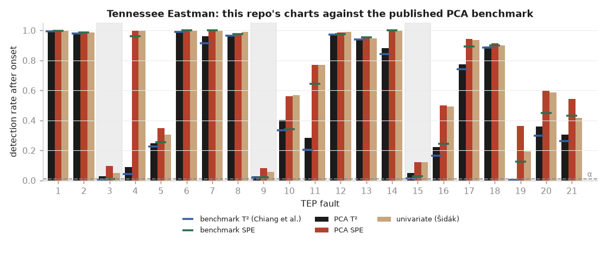</p>

| | T² | SPE |
|---|---:|---:|
| Mean \|ours − benchmark\| over 21 faults | 0.027 | 0.074 |
| Faults within ±0.05 of the benchmark | 17 / 21 | 10 / 21 |
| Correlation with the benchmark across faults | 0.999 | 0.985 |
| Largest gap | fault 11 (0.077) | fault 16 (0.255) |

The qualitative facts all hold, and the test suite asserts each of them:

- **Easy faults are caught.** Faults 1, 2, 6, 7, 8, 12, 13, 14 and 18 are
  detected on more than 85% of faulty samples by SPE. Fault 1 reaches 0.993
  on T² and 0.998 on SPE, against a benchmark of 0.992 and 0.997.
- **Fault 4 is a residual fault.** The reactor cooling-water step is invisible
  to T² (0.087) and obvious to SPE (0.996). The benchmark gives 0.044 and
  0.962.
- **Faults 3, 9 and 15 are undetectable, as published.** Detection stays at
  0.026–0.050 on T² and 0.081–0.120 on SPE. That is the false-alarm rate, not
  detection. Faults 3 and 9 never produce six consecutive T² or SPE alarms
  in the 800 faulty samples. Fault 15 first does so after 674 samples (34
  hours), which no one would call a detection.

The SPE gap runs one way. Ours is higher than the benchmark on average
(+0.074), and the excess matches the SPE false-alarm rate below. Our SPE
limit alarms on 7.1% of new normal samples, so part of the higher SPE
"detection" on the weak faults (10, 16, 19, 20, 21) is false alarms. The
benchmark's SPE false-alarm rate isn't reproduced here, so whether it used the
same limit can't be checked.

Detection delays, measured as the first of six consecutive alarms after the
onset (3 minutes per sample):

| Fault | T² | SPE | Univariate |
|---|---:|---:|---:|
| 1 | 18 min | 6 min | 6 min |
| 2 | 48 min | 30 min | 30 min |
| 6 | 18 min | 0 | 0 |
| 13 | 144 min | 108 min | 126 min |
| 17 | 84 min | 69 min | 63 min |

### Calibration: textbook limits work on TEP and fail on SECOM

The SECOM multivariate section found the textbook limits far too tight: 15.8%
of Phase I runs alarmed against a nominal ≤ 2%. That could be a bug in
`secom.mspc` or a property of SECOM. TEP separates the two, because the same
code at the same α is applied to data close to its assumptions (median excess
kurtosis −0.11, against 6.76 for SECOM's baseline sensors).

<p align="center">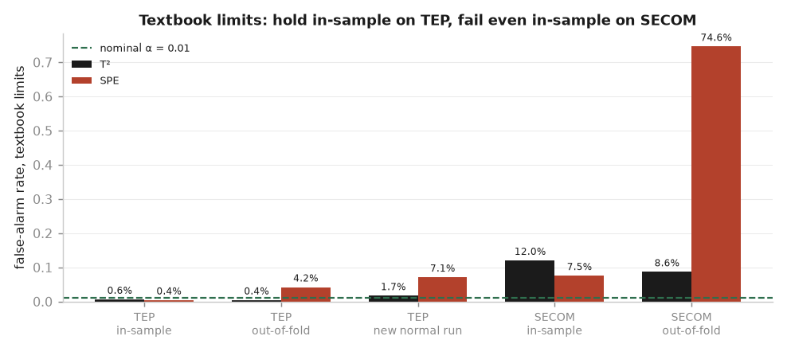</p>

| False-alarm rate, textbook limits | T² | SPE |
|---|---:|---:|
| TEP, training data (in-sample) | 0.6% | 0.4% |
| TEP, training data scored out of fold | 0.4% | 4.2% |
| TEP, independent normal run (`d00_te`) | 1.7% | 7.1% |
| TEP, pre-fault samples of all 21 test runs | 1.0% | 5.4% |
| SECOM, Phase I baseline (in-sample) | 12.0% | 7.5% |
| SECOM, Phase I baseline scored out of fold | 8.6% | 74.6% |
| Nominal | 1.0% | 1.0% |

The like-for-like comparison is in-sample: the same code, the same α, each
model scored on the data it was fitted to. TEP stays under nominal (0.6% and
0.4%), while SECOM runs at 12× and 7.5× nominal. **The SECOM failure is a
property of the data, not of the implementation.** The T² limit also holds
on new TEP data (1.7% on `d00_te`, 1.0% pooled over the pre-fault windows).

The SPE limit is less robust, and that applies to TEP too. On new normal data
it alarms at 5–7× nominal, and the rate rises with the number of retained
components: 3.5% at A = 5, 7.1% at A = 11, 16.6% at A = 24 (the 80% variance
rule used on SECOM). A model with more components fits the residual subspace
more closely to the one training run, and a new run doesn't share it. SECOM
shows the extreme case of the same effect: 81 components from about 574 runs
per fold, and an out-of-fold SPE false-alarm rate of 74.6%. On TEP, the
cross-validated limits bring SPE to 2.2% on `d00_te` but move T² from 1.7% to
4.7%. They are not uniformly better, so the textbook limits remain primary
here (D38).

### The moving-range sigma breaks on autocorrelated data

The SECOM sensor charts take sigma from the average moving range, which is
the textbook estimator for individuals charts and is unbiased only when
successive points are independent. TEP violates that. The median lag-1
autocorrelation is 0.55, 30 of 52 variables exceed 0.5, and the analyser
compositions XMEAS(37)–(41), which hold each value between samples, exceed
0.75.

The moving-range sigma falls to a median 0.40 of the overall SD (minimum
0.009), and the shortfall follows the autocorrelation closely (Spearman
ρ = −0.94). The same 52-chart Šidák family with moving-range sigma alarms on
**100%** of `d00_te`. With the overall SD it alarms on 4.0%. The univariate
results above therefore use the SD. That chart detects about as well as SPE
(fault 11: 0.769 vs 0.770), at a family false-alarm rate of 4.0% on `d00_te`
and 2.3% pooled over the pre-fault windows.

The finding carries back to SECOM only partly. SECOM runs are close to
independent (median lag-1 autocorrelation 0.04 over the baseline sensors), so
this failure mode doesn't apply there. Even so, SECOM's moving-range sigma is
a median 0.78 of the SD, because of heavy tails and level shifts. The
per-sensor Phase I limits are correspondingly narrower than SD-based limits
would be, which is one reason a raw beyond-limits count overstates excursions
(D40).

<p align="center">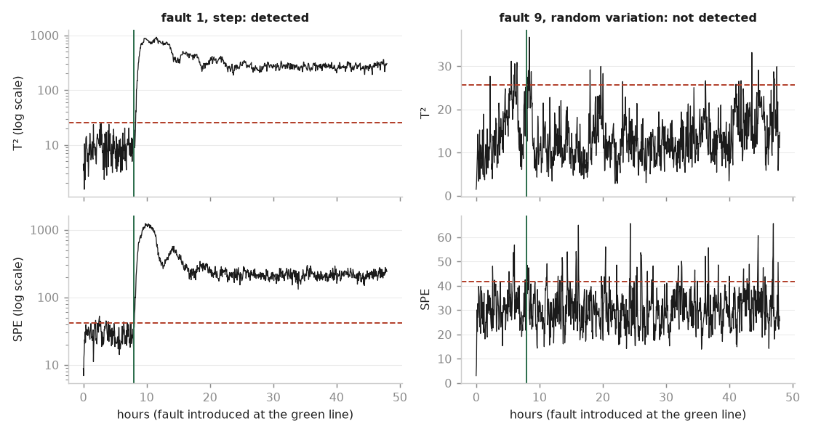</p>
<p align="center"><sub><b>Detectable and undetectable, by construction.</b> Fault 1 (left) lifts both
statistics by two orders of magnitude within an hour. Fault 9 (right), a random variation in the D
feed temperature, leaves T² and SPE indistinguishable from normal operation, and from 0.981 missed
detection in the published benchmark.</sub></p>

### What this validation does not establish

- **That the methods work on SECOM.** TEP is a simulated chemical process with
  near-Gaussian, autocorrelated variables. SECOM is real, heavy-tailed and
  close to independent. The validation shows the implementation is correct
  and isolates the cause of the SECOM calibration failure. It does not show
  that any SECOM chart detects a real fab fault.
- **Exact agreement with the published table.** The benchmark values are a
  secondary transcription, and the benchmark's own false-alarm rates and
  limit details weren't available to compare against.

---

## 10. The monitoring scheme, operating

The recommendation is a Bernoulli CUSUM against the week 35–39 baseline as the
live yield monitor, a g-chart alongside it as an improvement detector, and S060
on a watchlist. `secom monitor` runs that scheme through the 1,567 SECOM runs in
time order, one run at a time, so the recommendation can be seen working rather
than read about.

<p align="center">
  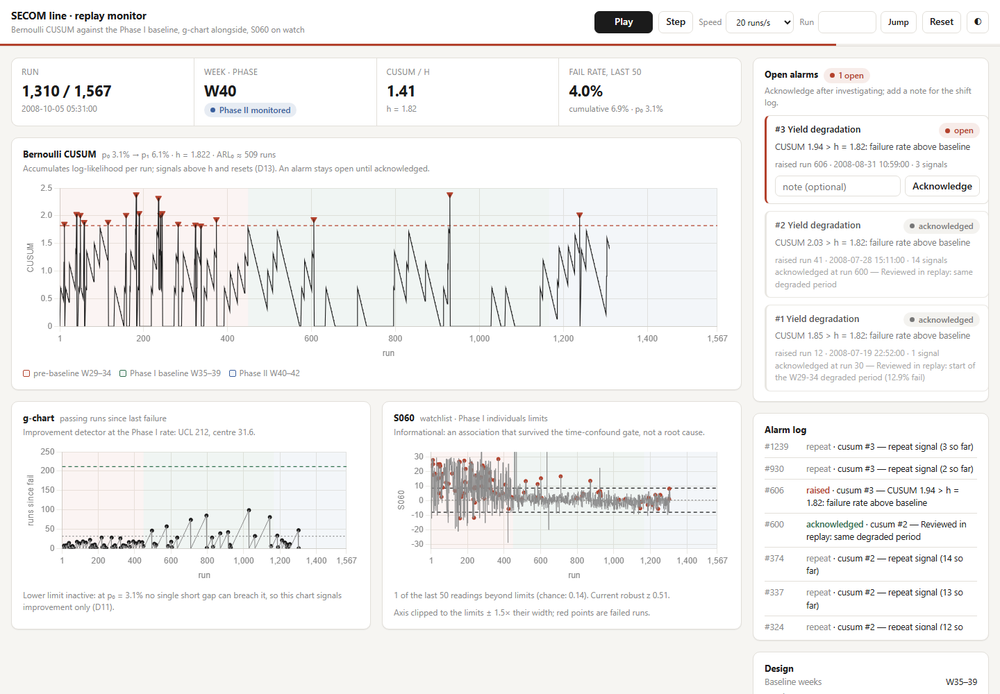
</p>
<p align="center">
  <sub><b>Run 1,310, week 40.</b> The opening excursion has been worked as two acknowledged
  alarms. A third, raised at run 606 in the baseline window, is open. The g-chart has never
  approached its 212-run UCL. S060 is shown against its Phase I limits, for information only.
  A dark-theme capture is in <code>docs/img/monitor-dark.png</code>.</sub>
</p>

### Running it

```bash
secom monitor                 # http://127.0.0.1:8050/
secom monitor --speed 50 --open
```

| Flag | Default | Purpose |
|---|---|---|
| `--port` | 8050 | Port to listen on |
| `--host` | 127.0.0.1 | Interface to bind |
| `--speed` | 20 | Initial playback speed, runs per second |
| `--open` | off | Open the page in the default browser |
| `--root` | cwd | Repository root holding `reports/` and `data/powerbi/` |

The page has play/pause, single step (→), speed, jump-to-run and reset controls.
Space toggles playback. URL options `?theme=light|dark`, `?speed=N` and
`?autoplay=1` are there for demos and screenshots.

It starts in about a second because it reads the committed pipeline outputs
(`reports/results.json` and `data/powerbi/`) instead of rerunning the analysis.
After changing the config, run `secom run` first so the monitor picks up the new
design. Nothing beyond the core dependencies is required. The server is the
standard library, and the page loads Chart.js 4.4.1 from cdnjs.

### What each panel is

**CUSUM.** It shows the statistic, the decision interval h = 1.822, a marker on
every signalling run, and bands for the three regimes. The values are the batch
CUSUM's, not a lookalike. The online implementation reproduces
`spc.bernoulli_cusum` bit for bit, and the exported `fact_run.cusum` column to
the CSV's 4×10⁻¹⁶ rounding. Both are asserted in `tests/test_monitor.py`.

**Alarms.** This panel is the operational layer the batch chart does not have,
and the distinction matters (D35):

- **The statistic resets the moment it signals (D13).** The chart starts again
  against the process as it now stands.
- **The alarm does not reset.** It stays open until someone acknowledges it,
  with an optional note for the shift log. Signals while it is open count
  against it instead of raising new alarms, so one excursion is one
  investigation.

Left unacknowledged, all 21 signalling runs of the campaign fold into a single
alarm raised at run 12, 0.46 days in. That is the same detection time as §3,
seen from the line.

**g-chart.** It shows passing runs since the last failure against exact
geometric limits at the Phase I rate (UCL 212, centre 31.6). The open gap is
tracked live, so an improvement would be signalled on the run where the gap
crosses the UCL, without waiting for the next failure to close it. Over this
campaign it never signals: the longest gap is 99 runs. The page states that the
lower limit is inactive at this rate (D11), so the chart cannot be mistaken for
a degradation detector.

**S060.** Each reading is plotted against S060's Phase I individuals limits,
with failed runs marked and the exceedance count over the last 50 runs shown
against the 0.14 expected by chance. It never raises an alarm. 278 of 1,567
readings (17.7%) fall outside limits that expect 0.27%, because the sensor
drifts. An alarm on it would fire continually and teach the line to ignore
alarms. That is the practical meaning of "watchlist, not root cause" (D36).

### API

The page is a thin client over a JSON API that can be scripted directly:

| Method | Path | Body | Effect |
|---|---|---|---|
| GET | `/api/design` | – | Fixed design: p₀, p₁, h, ARL₀, g-chart and S060 limits, phase spans |
| GET | `/api/state?since=K` | – | Current state plus history points from index K |
| POST | `/api/step` | `{"n": 5}` | Advance n runs (at most 2,000 per call) |
| POST | `/api/seek` | `{"run": 400}` | Replay from the start to run 400 |
| POST | `/api/reset` | `{}` | Back to run 0; acknowledgements cleared |
| POST | `/api/ack` | `{"alarm_id": 1, "note": "…"}` | Acknowledge at the current run (409 if unknown or closed) |

Every response is a deterministic function of the requests before it. A seek
replays from run 0 and re-applies acknowledgements made at or before the
target. A seek back past an acknowledgement removes it, as if the
acknowledgement had not happened yet.

### Where it lives

| File | Contents |
|---|---|
| `src/secom/monitor.py` | Online CUSUM, g-chart and watchlist trackers, alarm book, replay session, loader |
| `src/secom/monitor_server.py` | Standard-library HTTP server and JSON API |
| `src/secom/monitor_static/index.html` | The page (light and dark themes) |
| `tests/test_monitor.py` | 47 tests: batch equivalence, alarm semantics, replay determinism, the HTTP API |

---

## 11. Delivered artefacts

- **The analysis as a package.** `secom run` executes twelve pipeline stages
  configured by `config/default.yaml` (**D25**); `secom validate tep` runs §9;
  `secom monitor` serves §10. A Docker image runs the same commands on Linux.
- **Documentation site.** MkDocs pages for setup, configuration, the pipeline
  architecture and a generated API reference, with this report and the decision
  log included from source.
- **A Power BI model**, described below and in `powerbi/README.md`.

The Power BI star schema (`data/powerbi/`):

| Table | Rows | Cols |
|---|---:|---:|
| `dim_date` | 91 | 12 |
| `dim_sensor` | 590 | 32 |
| `fact_run` | 1,567 | 15 |
| `fact_measurement` | 54,845 | 9 |
| `fact_yield_week` | 14 | 18 |
| `fact_gchart` | 103 | 9 |

`fact_measurement` carries the 35-sensor watchlist rather than all 412 — a full
unpivot is 645,604 rows, refreshes slowly, and nobody scrolls 412 sensors
(**D19**). The full cleaned table ships separately as
`data/processed/secom_clean_wide.csv`. `dim_sensor` deliberately keeps **all
590**, including the 178 excluded ones, so *why is this sensor not on the chart?*
is answerable inside the report.

Calculations are split between Python and DAX on a stated rule (**D20**): control
limits live in DAX so they respond to slicers; centre lines use `REMOVEFILTERS`
so an excursion cannot redefine normal as you drill into it; anything depending
on the Phase I baseline is precomputed in Python so filter context cannot
silently move it. The Power BI measures reproduce the Phase I-centred chart, and
agreement was verified to 8×10⁻¹⁷.

Timestamps export as ISO-8601 and every Power Query type is declared explicitly
(**D21**): the raw timestamps are day-first (`dd/MM/yyyy`) and Power BI applies
file locale on import, and Power Query's 200-row type inference sees only nulls in
`model_score` and would type it as text.

---

## 12. What this analysis cannot establish

Stated in full (**D22–D24**):

- **Causation.** S060 is an association that survives a time-confound check.
  Confirming it needs a designed experiment, not more of this data.
- **Whether the week-35 improvement was a process change or a measurement
  change.** A change in test limits or gauge would look identical in this data.
- **Generalisation beyond 2008 and beyond this line.** 89 days, one product.
- **S060's stability** — see the W40–42 caveat in §4.
- **The true in-control rate.** The change-point analysis (§8) finds one change
  and no further one: the post-change process runs at 4.27%, against the 3.07%
  Phase I baseline. A CUSUM designed on 3.07% will alarm more often than its
  designed ARL₀ if 4.27% is the sustained rate.
- **That the monitoring detects real fab faults.** SECOM has no fault labels.
  §9 validates the implementation on Tennessee Eastman, a simulated process
  with different statistics; it does not transfer detection power to SECOM.
- **Exact agreement with the published TEP benchmark.** The benchmark values
  were transcribed from secondary sources, not checked against the original
  table (**D38**).
- **Whether the sensor limits are too narrow.** The individuals charts take σ
  from the moving range. On SECOM that estimate is 0.78 of the overall SD, so
  the sensor limits are about 22% narrower than SD-based ones. Recorded rather
  than changed (**D40**).
- **No capability analysis (Cp/Cpk/Ppk).** Capability requires specification
  limits; SECOM publishes none and the sensors are unnamed and unitless.
  Computing capability against *control* limits instead is a common error that
  produces an authoritative-looking number with no meaning. Omitted deliberately.
- **No physical interpretation of any sensor.**

---

## Recommendation

Run the **Bernoulli CUSUM against the week 35–39 baseline** as the live yield
monitor (§3, operated as in §10). Tell whoever runs it what it costs: in
control, half of all streams false-alarm within 342 runs, under three weeks at
this line's cadence (§7). **Re-estimate p₀** as post-change data accumulates,
since the sustained rate may be nearer 4.3% than 3.07% (§8).

For improvement, a lower Bernoulli CUSUM detects far sooner than the g-chart
(§7); keep the g-chart as its readable companion. Keep the weekly p′-chart for
reporting, labelled with its blind spot. Put **S060** on a watchlist with a
scheduled re-test of its within-regime association — not on a root-cause
report.

Do **not** adopt the PCA T²/SPE chart as the yield monitor (§6), and do **not**
deploy run-level failure prediction on this data.
